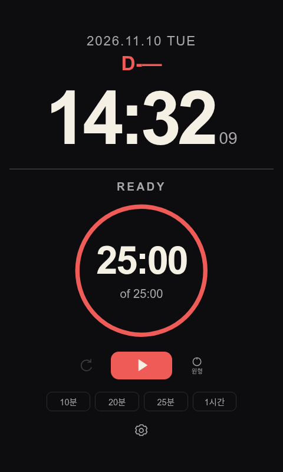
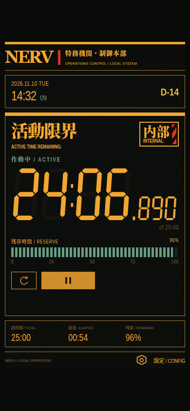
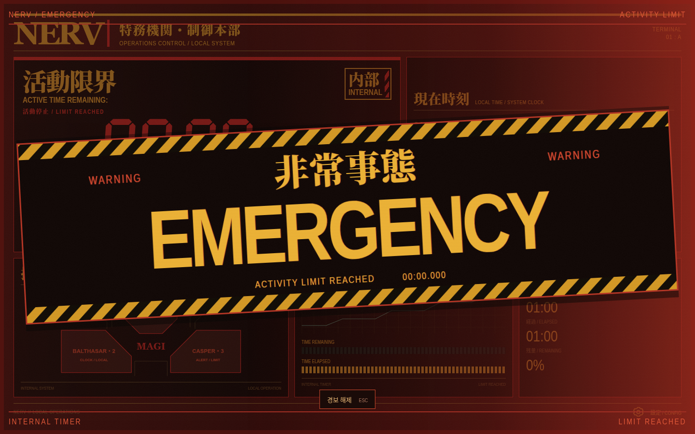

# Simple Clock

An offline clock and one-shot focus timer for your desk, with a minimal theme and an **Evangelion (1995) inspired control panel**. Adapts to narrow portrait windows and wide screens.

## Run

[Download and extract the ZIP](https://github.com/Junon-archive/simple-clock-web/archive/refs/heads/main.zip), then open **`index.html`** in your browser. No server, installation, build step, or internet connection needed to run.

## Preview

| Minimal | Evangelion |
| --- | --- |
|  |  |

**Wide-screen emergency alert**

## Features

- PC system clock with optional seconds; double-click the day countdown to change its date.
- Quick-start presets: **10, 20, 25, or 60 minutes**. Click the timer to set a custom duration; pause, resume, or reset anytime.
- Counterclockwise timer ring covering the full selected duration. No automatic breaks or repeating rounds.
- **30-second completion alerts:** gentle ring pulse or background flash in normal mode; a silent EMERGENCY overlay in Evangelion mode.
- Gear settings for themes, presets, and alerts. Enable **에반게리온 모드** under **디자인** and save. The app controls are currently in Korean.
- Settings and progress stay in browser local storage. Reopened timers resume paused; execution gaps over three seconds also pause them.

Built with plain HTML, CSS, JavaScript, and SVG. Keep the downloaded files together.

## Development

Run core tests with `node --test tests/core.cjs`. Browser checks in `tests/` require Playwright; development tools are not needed to use the app.

See the [specification](docs/SPEC.md), [Evangelion specification](docs/EVA_MODE_SPEC.md), and [work log](docs/WORKLOG.md) for details and recorded verification (currently in Korean). Actual OS sleep and other browser/OS combinations remain unverified.

Bundled font attribution: [SIL Open Font License](assets/FONT-LICENSE.txt).
